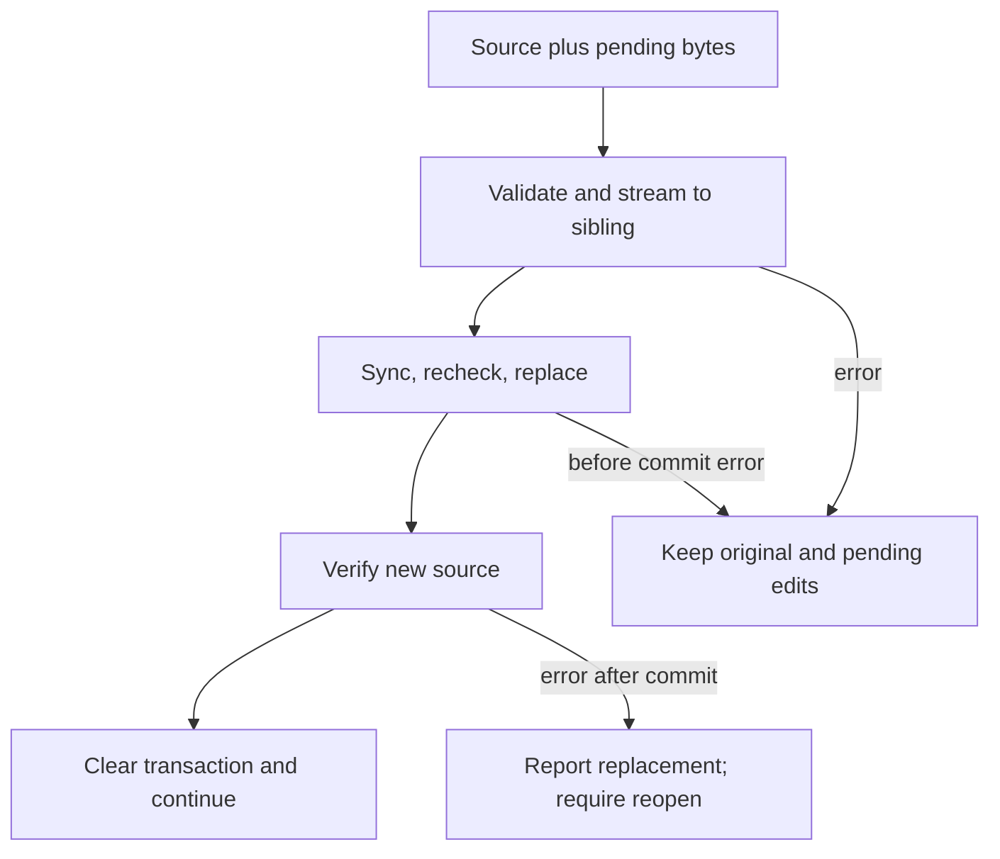

# ADR 0001: bounded raw-byte documents and replacement saves

Status: accepted for the first native overwrite editor; not a claim of complete
M1, device editing, or crash recovery. Related requirements: EDIT-001..022,
ADDR-001..002, IO-001..007, TEST-002/003/007/013.

## Decision

`hiewbie-core` owns a fixed-length `Document<S: ByteSource>`. File offsets use the
explicit `FileOffset(u64)` type. A source supplies bounded random reads; native
files and in-memory fixtures use the same logical document operations. No mmap
or whole-file buffer is required. A native source checks both the open handle
and the currently named file for identity/metadata changes around reads.
Unix opens use nonblocking flags before checking the opened object's type so
that an accidental FIFO, including a replacement FIFO, cannot stall the editor.
Only regular files are accepted by this adapter.

Pending overwrites live in a sparse ordered map containing only differing bytes.
History records contain the previous and next values for one changed span.
Validation, source reads, and resource checks precede mutation. Undo/redo need
no source reads. Overwriting a byte with its original value removes its pending
entry; a no-op does not erase redo. Insert/delete and a piece-table strategy
remain a separate decision, not a hidden whole-file copy.

| Resource | Initial bound |
| --- | ---: |
| One read / overwrite span | 64 KiB |
| Distinct pending byte offsets | 1 MiB |
| Combined undo and redo payload | 8 MiB |
| Combined history records | 4,096 |
| Search literal | 4,096 bytes |
| One search step | At most 64 KiB |

Map/history overhead is additional but bounded by entry/record counts. Limits
produce explicit errors before changing a transaction. They are not claims of
measured memory ceilings. Search uses incremental KMP, preserves matches across
chunks, and rejects stale document generations. Cancellation drops the search.
The frontend scans one bounded step per event-loop iteration.

## Save sequence and commit point

1. Verify source identity/metadata and the supported save policy.
2. For a clean transaction, reopen the verified source without rewriting it.
3. Create a private sibling temporary file in the destination directory.
4. Stream the logical document in 64 KiB blocks, including pending patches.
5. Preserve ordinary permissions; require unchanged Unix owner/group.
6. Sync the temporary file; recheck the source and temporary-file identities.
7. Replace the source path with the temporary file. This is the replacement
   commit point. Unix uses `NamedTempFile::persist`; Windows uses the pinned
   standard library's `fs::rename` after clearing the temporary file attribute.
   A cleanup guard remains active until the rename succeeds.
8. Verify the new handle/path and return it. Only then does the editor clear its
   overlay and history, leave edit mode, and display success.

Precommit failures retain the original file and pending history, except for any
independent external writer's changes. A failure after replacement uses a
distinct error and persistent UI state: the file was replaced, further editing
is blocked, and Esc exits so the user can reopen it. The application never
reports that an already completed replacement was rolled back.

The Windows distinction is required while readers retain open handles.
`tempfile` 3.23.0's Windows `persist` calls `MoveFileExW` alone;
[Rust 1.90.0's implementation](https://github.com/rust-lang/rust/blob/1.90.0/library/std/src/sys/fs/windows.rs)
can retry an access-denied replacement with `FileRenameInfoEx` and POSIX
replacement semantics. [Microsoft documents](https://learn.microsoft.com/en-us/windows-hardware/drivers/ddi/ntifs/ns-ntifs-_file_rename_information)
that existing handles then retain access to the old file while new opens use
the replacement. Native CI exposed this difference: ordinary `fs::rename`
replacement passed, but the original tempfile-based save failed. The regression
now asserts both readers' byte sequences. Source/link/conflict checks remain in
place, and operation-specific I/O errors identify the failed save stage.

## Initial policy and limits

- Read-only files, symbolic-link saves, and hard-linked saves are refused.
  Reading through a symlink remains allowed. Refusing links avoids silently
  breaking the relationship between aliases during replacement.
- The original file length, modification time, identity, and available metadata
  must stay unchanged. Unix also compares device/inode, link count, mode,
  owner/group, and change time. Access time is excluded because reads may change
  it. The safe `same-file` handle wrapper supplies portable identity checks;
  its Windows identity has documented filesystem-specific false-positive limits.
- Ordinary mode/executable bits are preserved. ACLs, xattrs, alternate data
  streams, security labels, and every filesystem-specific metadata field are not
  copied or guaranteed. Files needing those semantics require a later strategy.
- The final validation and rename are not a cross-process compare-and-swap.
  Another writer can race that interval; metadata-preserving writes can also
  evade metadata checks. No cross-process locking or hostile-writer guarantee
  is claimed. Concurrent truncation is an I/O/conflict error, not a mapped-page
  fault. Temporary-path substitution is checked before rename.
- The temporary file is synced, but the containing directory is not fsynced.
  Power-loss durability and recovery journals remain open work. Atomic path
  replacement depends on the underlying filesystem's rename semantics.
- Save streams the full logical file and can need free space comparable to the
  file size. It is synchronous and has no progress/cancellation UI yet. Sparse
  extents are not preserved by this first copy strategy.
- Raw devices, in-place patching, Save As, resizing, recovery exports, and
  preserving earlier transactions across a completed save are not implemented.

## Evidence

[Core tests](../../crates/hiewbie-core/src/tests.rs) cover exact overlays,
overlapping undo/redo, bounds, limits, short reads, failure atomicity, search,
and fake sources above 4 GiB. [Native persistence tests](../../crates/hiewbie/tests/persistence.rs)
cover exact saved bytes, untouched ranges across block boundaries, discard and
clean-save timestamps, external changes, replacement, truncation, missing files,
readonly/link policies, Unix executable mode, and actual sparse-file reads and
pending edits beyond 4 GiB. The sparse test does not copy/save a multi-gigabyte
file. [Adapter tests](../../crates/hiewbie/src/file.rs) inject writer failure and
check temporary-path substitution. PTY tests exercise the real save path.

Exact dependency versions, sources, and licenses are in
[dependencies.md](../dependencies.md). Fixtures are generated by these tests;
no proprietary executable is included.
