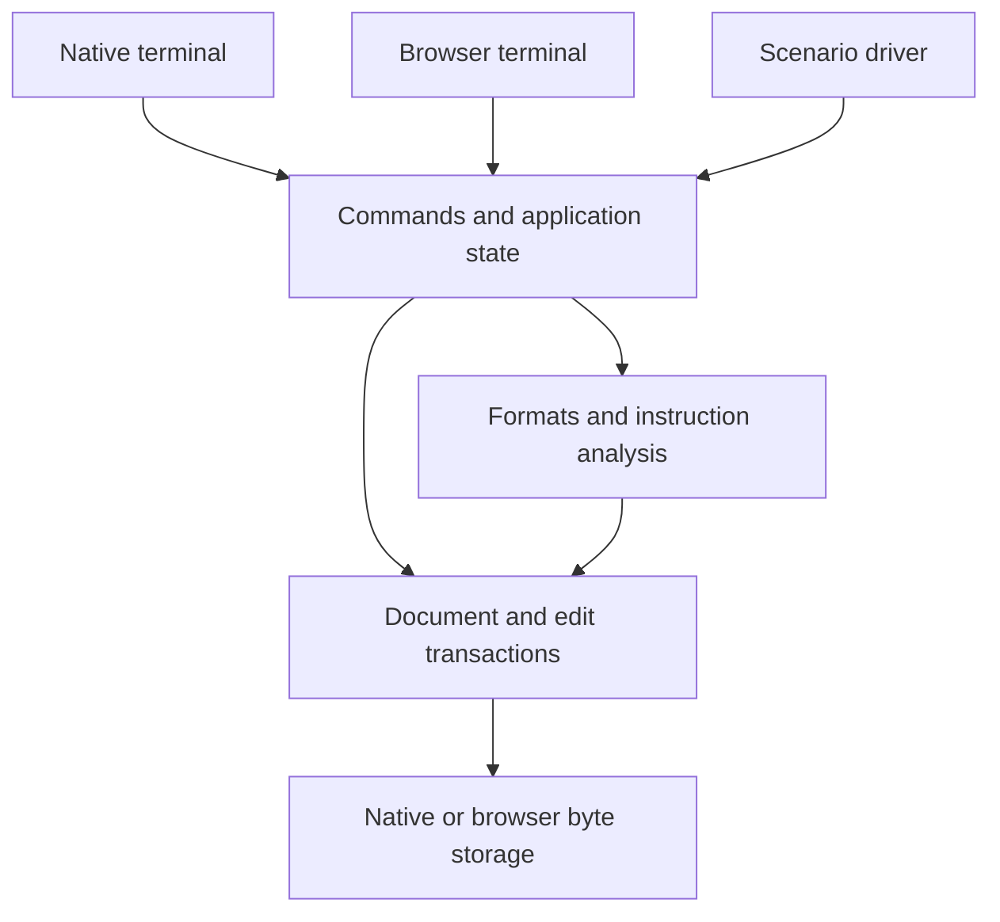

# Architecture and implementation plan

Status: implementation contract with native editing and initial executable
analysis. The core includes bounded format readers, instruction decoders and
shared analysis commands. Full analysis, the browser adapter and releases remain
incomplete. The
[compatibility ledger](compatibility-status.md) separates evidence from scope.

## 1. Design objective

Deliver the compact HIEW terminal workflow with a portable Rust implementation.
The first useful milestone is a real editor with predictable file semantics;
later milestones add executable analysis, textual instruction patches, advanced
compatibility, and the complete release matrix. macOS is a primary environment,
not a Wine packaging target.

The behavior contract is in [compatibility.md](compatibility.md). Host and release
requirements are in [build-and-release.md](build-and-release.md).

## 2. Shared command and document model

All input paths must use the same application commands. Keybindings, menus,
macros, a headless test driver, and a future browser terminal must not each
implement their own edit semantics.

Suggested boundaries, to become modules or crates when justified:

| Boundary | Responsibility | Must not depend on |
| --- | --- | --- |
| Document | Logical bytes, selections, patches, undo, versions | TUI widgets or browser DOM |
| Storage | Bounded reads, persistence, file identity, capabilities | Executable parsing |
| Formats | Checked metadata and address mappings | Frontend state |
| Instructions | Decode, text assembly, branch/reference analysis | Host instruction set |
| Application | Commands, modes, history, transactions, effects | A specific terminal library |
| Native terminal | Input normalization, rendering, lifecycle | Direct mutation of file bytes |
| Browser adapter | Terminal rendering and local file import/export | Native filesystem assumptions |
| xtask | Check, build, package, release verification | A particular interactive shell |

Prefer a small initial workspace with a core library, a terminal application,
and `xtask`. Add separate backends or frontend crates as actual dependency and
platform boundaries appear. Do not create empty crates merely to match this table.

Current boundaries are `crates/hiewbie-core` (document, addresses, formats,
instructions, commands and search),
`crates/hiewbie` (native storage, CLI, Ratatui frontend), and `xtask` (checks and
target builds). Selected engines are pure Rust and enter only the portable core.
The diagram also contains planned consumers; it does not claim a browser UI.

## 3. Document and storage contracts

- Use `u64`-based checked offset/length types. Convert to `usize` only for a
  bounded buffer that has already passed size checks.
- Distinguish file offset, RVA, virtual address, and slice-relative offset.
  Translation returns a result that can represent unmapped or ambiguous ranges.
- Expose bounded random access through a storage abstraction. A file does not
  need to fit in memory or the host address space.
- Keep pending changes separate from persisted bytes. Text, hex, disassembly,
  structure views, and search all read the same logical document version.
- Support overwrite efficiently and design insert/delete without cloning the
  whole document per edit. A piece table, interval map, or equivalent structure
  is an implementation decision to benchmark.
- Define snapshots and generation IDs so background results cannot overwrite
  newer edits. Invalidate relevant analysis when bytes or mappings change.
- Long searches and analysis are cancellable, report progress, and have explicit
  memory/work limits. First display must not wait for whole-file analysis.
- An editor block holds a file anchor and a tracked or fixed endpoint. Both
  marked bytes belong to the range. The selection needs constant storage and
  is independent of analysis profiles and document generations. Block search
  captures the fixed range when the user confirms the query.
- The editor owns the search request and resume point. A pending scan reads a
  single document generation in bounded steps. A completed scan updates the
  resume point, and a canceled scan leaves the previous completed request
  available. Frontends translate keys and display progress.
- External modification, truncation, replacement, and loss of permissions must
  be handled explicitly. A naive file-wide mapping can fault when another
  process truncates the file; choose paging or a controlled mapping strategy.

## 4. Persistence and editing

Specify transaction behavior before implementing UI shortcuts. The compatibility
contract distinguishes entering edit mode, committing an edit, saving, discarding
an active edit, and undoing a previous command.

For ordinary files, provide a persistence strategy that detects conflicting
external changes, handles partial writes and disk-full failures, and preserves
intended metadata. Document atomic replacement versus explicit in-place patching
and their implications for large files, symlinks, hard links, and open handles.
No successful-save indication may precede completion of the promised write.
Logical edit transactions can be atomic even when a storage backend cannot make
persistence atomic. In-place file or device writes may partially succeed: report
written and uncertain ranges, preserve recovery information, and reconcile the
actual backing data before retrying. Do not promise rollback that the backend
cannot provide.

A block export carries its file range to a platform adapter as a read effect.
The native adapter stages the selected logical bytes and any preserved output
bytes in a sibling temporary file. It commits only after explicit acceptance
and revalidation. Check the [storage ADR](adr/0001-document-storage.md#block-export)
for destination collision and cancellation behavior.

Text assembly is a document operation with an explicit architecture, mode,
endianness, current virtual address, and allowed patch span. Preview resulting
bytes and instruction length. Reject oversized output before changing the
document; padding and widening a patch are explicit operations. Encoding failure
must leave bytes, undo history, and dirty state unchanged.

An arbitrary byte patch must not silently rebuild sections, move instructions,
repair checksums, alter signatures, or rewrite relocations. Such operations may
exist as named, separately tested commands.

## 5. Format and instruction backends

Every backend exposes capabilities; a decoder must not imply a corresponding
text assembler, symbol resolver, or reference analyzer. Format detection must
also be independent of instruction selection, with a manual override for raw
data and incorrectly labeled binaries.

Prefer owned, validated metadata or narrowly scoped borrows over references into
mutable file mappings. Malformed counts, overlapping regions, zero-fill sections,
truncated strings, unsupported relocations, and huge symbol tables must produce
bounded, actionable results while leaving raw access available.

Cache keys include document generation, instruction architecture, mode,
endianness, base address, and selected Mach-O slice. Changing any of these must
not leave stale addresses or decoded instructions visible.

Selected terminal stack and remaining dependency candidates:

| Area | Candidate | Decision to resolve |
| --- | --- | --- |
| Terminal | Ratatui 0.29.0 / Crossterm 0.28.1 selected | [Input ADR](adr/0002-terminal-input.md); enhanced keys and ConPTY remain gaps |
| x86 | iced-x86 1.22.0 selected | Bounded 16/32/64 decoder; text assembly and exhaustive extension coverage remain separate |
| ARM families | yaxpeax-arm 0.5.0 / yaxpeax-arch 0.3.3 selected | Strict ARM/Thumb/AArch64 decoding; revision, extension, endian and IT-state gaps remain explicit |
| Executable parsing | Focused bounded readers selected | PE/ELF/Mach-O headers and mappings; full symbols/sections/legacy interpretation remains incomplete |
| Text assembly | LLVM MC, a permissive parser/backend, or evaluated Keystone integration | Syntax fidelity, footprint, licenses, all host targets and WASM |

Keystone has GPLv2 terms and a FOSS exception; do not call it an MIT dependency.
The exception and distribution obligations must be evaluated before choosing it.
The `object` crate documents a trusted-input scope; using it does not remove the
need to assess arbitrary-input behavior. See the source links in
[references-and-reuse.md](references-and-reuse.md).

Symbol inspection is a separate on-demand layer over the same `Document` and
selected `Executable`. It owns its metadata, validates complete table/string
spans, and has independent cumulative read, entry, name and retained-text limits.
Its cache keys are document generation and selected image; decoder overrides do
not reparse format tables. Failure retains raw bytes and usable header mappings.
The model distinguishes virtual definitions, section-relative file targets,
import pointer slots, unresolved names and exact source records. Frontends use
shared target/record commands. The [symbol ADR](adr/0005-symbol-navigation.md)
records current PE/ELF/Mach-O coverage and explicit loader-metadata gaps.

## 6. Frontend behavior

Represent input as semantic events and dispatch through a versioned command
registry. Context includes view, edit state, selection, active dialog, and current
backend capabilities. The same registry supplies contextual F-key help,
keybinding configuration, macro execution, and the scenario driver.

The terminal adapter owns raw mode, alternate screen, cursor, mouse capture,
paste protocol, and negotiated keyboard enhancements. Restore every acquired
mode on normal exit and recoverable error/unwind paths. Never require global
keyboard monitoring to make an SSH session usable.

Render only the required viewport and coalesce redraws. Use deterministic cell
snapshots for UI tests, including narrow screens, resizing, Unicode width,
selection, dirty bytes, errors, and the function-key bar.

The WASM product uses the same document/command behavior through a browser
terminal adapter. It needs real local file import, navigation, edit, and patched
file export. Native device access and Windows DLL extensions have separate,
explicit capability limits. An empty WASM build is not a Web release.

## 7. Verification strategy

Use generated or permissively licensed fixtures with provenance. Store expected
bytes and addresses rather than distributing proprietary reference binaries.

| Level | Evidence |
| --- | --- |
| Core | Property tests for edit algebra, boundaries, address translation, undo and persistence |
| Backends | Known instruction encodings, invalid inputs, relative addressing, format fixtures |
| Application | Deterministic commands replayed against the same logical document |
| Terminal | PTY/ConPTY workflows and cell snapshots, including real key decoding |
| Browser | Import/edit/export and key translation tested in a browser harness |
| Performance | Sparse files beyond 4 GiB, bounded memory, first-screen timing, cancellation |
| Distribution | Unpack every required artifact, verify architecture, launch and edit a fixture |

Fuzz parsers, address arithmetic, decoder adapters, search patterns, and document
operations. A panic is a failure, including in a native dependency boundary.
Compare architecture-neutral command results across hosts. Manual discovery is
useful, but repetitive validation must be automated.

## 8. Implementation sequence and exit criteria

Each milestone is independently reviewable; it does not silently narrow the full
compatibility contract. The terminal application is the first user-facing product.

| Milestone | Deliverable | Exit evidence |
| --- | --- | --- |
| M0: executable plan | Rust workspace, command inventory, dependency ADRs, native CI and full target build feasibility | Fresh checkout checks; each target has a reproducible build strategy or an explicit blocker |
| M1: useful editor | Open, text/hex views, navigation, search, edits, discard/save, large-file access and terminal lifecycle | End-to-end edit scenario; exact output bytes; no whole-file allocation |
| M2: executable analysis | PE/ELF/Mach-O, x86 and ARM families, symbols, references, branches and headers | Shared fixture matrix, ARM64 Mac analyzing x86 PE, and the reverse |
| M3: instruction patching | Real textual ASM input, patch preview, address-aware encoding, undo/redo and block operations | Branch-encoding cases, oversized patch rejection, save/reopen round trips |
| M4: advanced parity | Remaining legacy formats, instruction-pattern search, macros, calculator, transforms, annotations and extension workflow | Every parity row has a status, tests, and documented platform exceptions |
| M5: full distribution | All required OS/CPU artifacts and functional WebAssembly terminal frontend | Complete release manifest and artifact smoke tests; no omitted mandatory leg |
| M6: improvements | Additional ISAs, richer diffs/patch export, automation and analysis features | Additive behavior with maintained compatibility scenarios |

Platform feasibility belongs in M0 even when an artifact is delivered in M5.
In particular, assembly backends, native C dependencies, FreeBSD AArch64, and WASM
must be investigated before they become expensive architectural commitments.

## 9. Early architectural decision records

The first implementation work should record concise ADRs for:

1. Text assembly engine, grammar, architecture coverage, licenses, and packaging.
2. Document storage, overwrite/insert/delete structure, persistence and recovery.
3. Input/keymap compatibility and terminal protocol fallback.
4. Format parser choice, legacy gaps, and malformed-input resource limits.
5. Full build matrix, FreeBSD ARM64 toolchain, minimum OS/libc versions, and WASM.

Use concrete experiments to settle these decisions. A dependency name alone is
not an implementation plan or proof of compatibility.

Implemented decisions: [bounded storage and saving](adr/0001-document-storage.md),
[terminal/input](adr/0002-terminal-input.md), and
[build-target strategies](adr/0003-build-targets.md). The
[analysis decision](adr/0004-analysis-backends.md) records selected readers and
decoders, concrete experiments, limits and the remaining text-assembly gate.
The [symbol decision](adr/0005-symbol-navigation.md) adds lazy bounded table
interpretation and target/record navigation without a new dependency.
M0, M1 and M2 remain partial until their full exit criteria and affected platform
coverage are satisfied.
